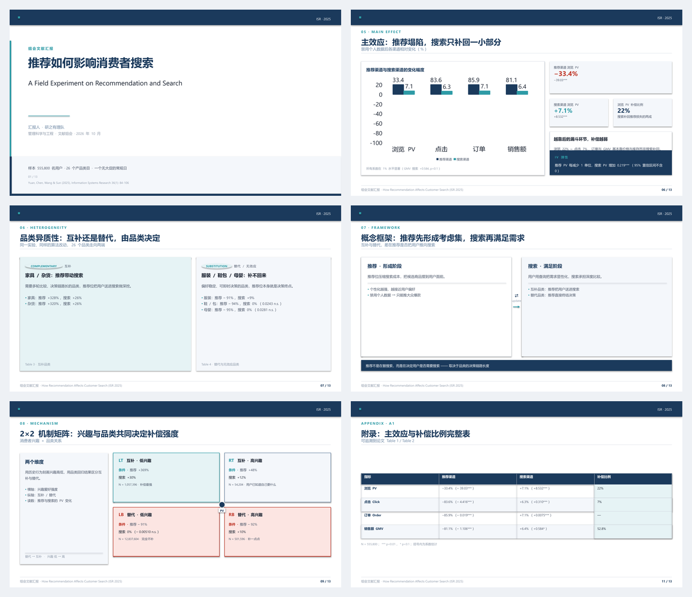

# Deep Ocean Slides · 深海学术风幻灯片

> **像论文，不像海报。** — 把一套打磨好的学术风 16:9 PPT 设计规范，变成可执行、可检查、可复用的代码。
>
> **完全离线 · 不需要 API key · 零成本**：论文 PDF → 可编辑 `.pptx` + 单文件 HTML + 自动排版自检，
> 全程本地完成（联网仅在你主动使用可选的 `--llm` 时才需要）。

[](https://github.com/wst320727254-beep/deep-ocean-slides/actions/workflows/ci.yml)
[](LICENSE)
[](pyproject.toml)
[](#给朋友用两种装法)
[](docs/STYLE.md)
[](docs/STYLE.md#版式库)



---

## 这是什么

一份**组会/开题/答辩用的学术汇报风格规范**（深蓝顶条 + 青绿点缀 + 卡片撑满 + 每页一个证据锚点），
被工程化成三种可用的形态：

| 形态 | 产物 | 适合谁 |
|---|---|---|
| **生成器** | `deepocean build deck.yaml` → 真·`.pptx`（可继续在 PowerPoint 里改） | 想批量出稿、换论文复用版式的人 |
| **网页版** | `deepocean html deck.yaml` → 单文件 HTML，浏览器打开、Ctrl+P 直接导出 PDF | 要发给别人看、或不想装 Office 的人 |
| **设计规范** | [`docs/STYLE.md`](docs/STYLE.md)：颜色/字号/母版/组件/逐页坐标全表 | 想手工在 PowerPoint / Keynote / Figma 里复刻的人 |

再加一条离线通路：**论文 PDF → 摘要包 → deck**（[`docs/AUTHORING.md`](docs/AUTHORING.md) 写作契约 +
`deepocean normalize` 离线修结构 + `deepocean check` 自检），以及给 AI agent 用的
[`skills/deep-ocean-slides/`](skills/deep-ocean-slides/SKILL.md)。

外加一件多数模板缺的东西：**自动排版自检**。规范里"红色不超过 6%""正文不小于 13px""内容页必须撑满"
这些原本只能靠眼睛盯的条目，现在是 `deepocean check` 里 31 条可执行的规则。

## 特性


- **设计令牌单一事实来源**：`src/deepocean/tokens.py` 一处定义颜色、字号阶梯、四区母版、配比预算；
  生成器、网页渲染器、linter、CSS 变量全部从它派生，改一个数字全篇同步。
- **13 个版式**：封面、非对称双栏、巨型数字、实验设计、技术路线、左图右洞察、双栏对比卡、
  概念框架、2×2 矩阵、数据表、结论横幅、结尾页 —— 全部有字段契约（[`schema.py`](src/deepocean/schema.py)），
  写错字段名会被 `check` 当场指出。
- **真正能编辑的 PPTX**：不是把网页截图塞进幻灯片，而是原生形状、文本框、可编辑图表
  （数据标签、系列配色都按规范设置好），并且写入了 PowerPoint 主题色 —— 你在 Office 里调色板看到的
  就是 Deep Ocean 的那几个色。
- **零依赖的网页版**：单文件 HTML，内联 CSS + 手绘 SVG 图表，离线可用、无 CDN、无 JS 框架，可直接打印成 PDF。
- **自动自检**：`M001` 越界、`T002` 正文字号过小、`C002` 用了禁用色（紫/粉/金）、`C003` 红墨超 6%、
  `R003` 连续三页无峰值、`X001` 占位文字没删干净…… 31 条规则，其中"无 error"可直接当 CI 门禁
  （`deepocean check`），`--strict` 则把 `warn` 也当成待收敛项。
- **中英双语文档 + 可复制的复刻教程**：从本仓库 CLI、纯手工 PowerPoint、Keynote、Figma/Canva 到
  用 Python API 自定义版式，六条路线都有。

## 安装

尚未发布到 PyPI，从源码安装：

```bash
git clone https://github.com/wst320727254-beep/deep-ocean-slides.git
cd deep-ocean-slides
pip install -e ".[yaml,paper]"   # paper 只在你直接用 PDF 出初稿时才需要
```

依赖只有 `python-pptx` 与 `Pillow`，Python 3.9+。

## 给朋友用（三步）

```bash
# 1. 安装（Python 3.9+，一条命令）
pip install "deep-ocean-slides[yaml,paper] @ git+https://github.com/wst320727254-beep/deep-ocean-slides.git"

# 2. 配置自己的模型 key（不配也能用：退回离线骨架，只是不改写中文叙事）
#    Windows PowerShell:
[Environment]::SetEnvironmentVariable('DEEPSEEK_API_KEY','sk-你的key','User')
#    macOS / Linux:  export DEEPSEEK_API_KEY=sk-你的key

# 3. 一篇论文出成品
deepocean from-paper "论文.pdf" --llm --journal "ISR · 2025" --max-figures 1 --build
deepocean check "论文.deck.yaml" --strict       # 必须 0 error / 0 warn
deepocean html  "论文.deck.yaml" -o "论文.html"  # 可选：网页版，Ctrl+P 导 PDF
```

**用 AI agent 的话（Claude Code / Codex / DSH 等）**：把仓库里的
[`skills/deep-ocean-slides/`](skills/deep-ocean-slides/SKILL.md) 放进你的 skills 目录，
agent 会按 `SKILL.md` 的四步流程执行，并遵守里面的质量闸门（"必须逐页渲染看图"、
"数字必须带页码"、"配图 ≤ 2 页"、"不编造"）。不装 agent skill 也能用——命令行本身就是完整流程。

> API key 属于每个使用者自己：不要共用、不要提交进仓库。本仓库全程不读写 key 文件。

### 给朋友用：两种装法

| | **Download ZIP**（推荐给用 agent 的人） | **pip 直接从 GitHub 装**（推荐给只用命令行的人） |
|---|---|---|
| 拿到什么 | **整个仓库**：`skills/`、`docs/`、`examples/`、`tools/`、`assets/` 全都在 | 只有 Python 包（`deepocean` 命令）；**没有** `skills/`、`docs/`、`examples/` |
| 还需要一步 | 解压后在该目录执行 `pip install -e ".[yaml,paper]"` | 无，装完即可用 |
| 适合 | 要**让 AI agent 用这个技能**（agent 需要读 `SKILL.md` 与 `docs/AUTHORING.md`） | 只要 `deepocean` 命令跑流程 |
| 更新 | 重新下载 ZIP 覆盖（无版本历史） | `pip install -U` 重装（git 拉最新） |

```powershell
# ZIP 路线（Windows PowerShell）
Expand-Archive "$env:USERPROFILE\Downloads\deep-ocean-slides-main.zip" "$env:USERPROFILE\deep-ocean-slides"
cd "$env:USERPROFILE\deep-ocean-slides"
python -m pip install -e ".[yaml,paper]"
deepocean version                                  # 能打印版本就装好了
# 让 agent 用它：把 skills\deep-ocean-slides\ 放进你的 skills 目录
```

> 一句话：**两者都能出成品**；但"用 skill"必须走 ZIP（或 `git clone`），因为 pip 只装 Python 包，
> 不装技能说明书。<br>
> 另外记得装 **Python 3.9+**：Windows 用户可从 python.org 或 Microsoft Store 安装，安装时勾选
> "Add python.exe to PATH"。

## 60 秒上手

```bash
# 1. 生成一份 13 页完整示例（PPTX + 网页版 + 自检）
deepocean demo -o out --check

# 2. 用 3 页模板开自己的汇报
deepocean init mytalk
#    → mytalk/deck.yaml，改文字即可

# 3. 编译、看网页版、自检
deepocean build mytalk/deck.yaml -o out/mytalk.pptx
deepocean html  mytalk/deck.yaml -o out/mytalk.html
deepocean check mytalk/deck.yaml --strict
```

### 从一篇论文直接出初稿

把 PDF 丢给 `from-paper`：它会抽出章节、数字、表格和**可用的配图**，按版式节奏排成一份
可编译的 deck（离线、不调用模型；每一处数字都带原文页码）：

```bash
deepocean from-paper "汇报二 生成式AI.pdf" --journal "ISR · 2025" --max-figures 1 --build
#   → 汇报二 生成式AI.digest.md   摘要包（章节/数字/表格/候选配图）
#   → 汇报二 生成式AI.figures/   导出的配图 PNG（自动挑选、自动缩放）
#   → 汇报二 生成式AI.deck.yaml  8 页初稿（cover → 背景 → 方法 → 结果 → 证据 → 表格 → 发现 → 总结）
#   → 汇报二 生成式AI.pptx      顺带编译产物
```

想让它顺便改写叙事（而不是"原文要点罗列"）：加 `--llm`，并用 `DEEPSEEK_API_KEY`
或 `OPENAI_API_KEY` 提供密钥；模型输出会先过 schema 校验，不合格会自动要求它改一轮。

> 初稿不编造：文字来自原文句子，数字带页码，配图来自 PDF 内嵌图；提取不到的部分会明确写出
> "请对照原文补充"，而不是悄悄编一个。**配图最多 2 页**（默认 1 页）——这是规范里"图片不要多"的硬约束。

一份 deck 就是一个 YAML/JSON 文件：

```yaml
meta:
  title: 推荐如何影响消费者搜索
  kicker: 组会文献汇报
  journal: ISR · 2025
  source_note: 组会文献汇报 · ISR 2025, 36(1): 84-106

pages:
  - layout: cover
    title: 推荐如何影响消费者搜索
    data:
      english_title: How Recommendation Affects Customer Search
      authors: 汇报人 · 你的名字
      series: ISR · 2025

  - layout: chart_insight          # 左图表 + 右洞察
    kicker: 05 · MAIN EFFECT
    title: 主效应：推荐塌陷，搜索只补回一小部分
    hero: true                     # 这一页是"峰值页"
    data:
      chart:
        type: bar
        categories: [浏览 PV, 点击, 订单, 销售额]
        series:
          - {name: 推荐渠道, values: [-33.4, -83.6, -85.9, -81.1], color: navy}
          - {name: 搜索渠道, values: [7.1, 6.3, 7.1, 6.4], color: teal}
        height: 390
      kpis:
        - {value: "−33.4%", label: 推荐渠道浏览 PV, tone: down}
        - {value: "+7.1%",  label: 搜索渠道浏览 PV, tone: up}
      takeaway: {label: IV 弹性, text: 推荐 PV 每减少 1 单位，搜索 PV 增加 0.219***}
```

查询版式需要哪些字段：

```bash
deepocean layouts              # 全部 13 个版式的字段表
deepocean layouts chart_insight
```

## 用 Python API

```python
from deepocean import spec, build

deck = spec.Deck.load("examples/demo-deck.yaml")
result = build.build(deck, "out/demo.pptx")
print(result.path, result.pages, result.problems)
```

自定义一页（所有长度都是 1280×720 画布上的 px）：

```python
from deepocean import primitives as pr, tokens

def my_page(slide, page, ctx):
    pr.rect(slide, 40, 200, 1200, 440, fill="light", radius=8, line="line")
    pr.add_text(slide, 60, 220, 700, 60, pr.P([
        pr.T("自定义版式", "card_title"),
        pr.T(" · 40px 左边距，一切照规范", "card_body_sm", color="grayblue"),
    ]))
    pr.hairline(slide, 60, 300, 1160, color="line")     # 1px 分隔线
    pr.bullets(slide, 60, 320, 700, 280, ["改 token 就改全篇", "字距、行高、配比都不用记"])
```

新增一个版式的四步法见 [`docs/STYLE.md`](docs/STYLE.md#版式库)。

## 设计系统速览

**画布 1280 × 720 px**（= PowerPoint 16:9 = 13.333 × 7.5 in），左右安全边距 40，卡片间距 20。
四区母版：顶条 `y 0–60` / 标题块 `y 72–140` / 内容区 `y 200–640` / 页脚 `y 680–720`。

| token | 色值 | 用途 | 预算 |
|---|---|---|---|
| `navy` | `#1B3A5C` | 顶条、主标题、锚点数字、页码、深色卡 | 蓝族 35–50% |
| `teal` | `#2E9BA6` | 装饰条、正向数据、图标、流程箭头 | — |
| `grayblue` | `#6B86A3` | 副文、坐标轴、第三序列 | — |
| `brick` | `#C0392B` | 仅"下降/替代"类关键数字 | **≤ 6%** |
| `white` / `light` / `mint` / `pink` / `line` | `#FFFFFF` `#F4F7FB` `#E6F3F5` `#FCE5E2` `#D6DCE5` | 底色与卡片 | 白 35–55% |
| `t1/t2/t3` | `#1A2230` `#4A5568` `#8B97A8` | 文本主 / 副 / 辅 | — |

字号阶梯 `pt = px × 0.75`：封面主标 44px/33pt · 页面主标 30px/22.5pt · 眉标 14px/10.5pt（字距 2.5）
· 卡内正文 14px/10.5pt（行高 1.58）· KPI 巨数字 32–44px · 页脚 12px/9pt。

用 `deepocean tokens --md` 打印完整令牌表，`deepocean tokens --css` 拿到给网页用的 CSS 变量。

## 版式库

| layout | 用途 | 参考页 |
|---|---|---|
| `cover` | 封面（全屏视觉 + 大标题） | 01 |
| `two_column` | 非对称双栏 60:40，左主卡 + 右卡列 | 02 |
| `big_number` | 巨型数字 + 洞察（1 大 + 2 小） | 03 |
| `experiment_design` | 上流程 + 下对比组（Control / VS / Treatment） | 04 |
| `roadmap` | 左深蓝标题栏 + 右步骤列表 | 05 |
| `chart_insight` | 左大图 + 右 KPI/洞察卡 + 深色结论卡 | 06 / 10 |
| `split_cards` | 双栏对比卡（互补 vs 替代） | 07 |
| `concept_flow` | 左 → 中 ⇄ → 右 概念框架 | 08 |
| `matrix2x2` | 2×2 机制矩阵（380×190 象限 + 20px 中心点） | 09 |
| `data_table` | 数据表（深蓝表头 + 斑马纹 + 高亮列） | 附录 |
| `image_evidence` | 图片证据页（论文配图 + 图注 + 右侧解读，**全篇 ≤ 2 页**） | 配图 |
| `key_findings` | 深蓝横幅三个数字 + 下方启示卡 | 11 |
| `closing` | 加高顶条 + 金句区 + 局限/展望双卡 | 12 |

## 自动自检

```bash
deepocean check out/deep-ocean-demo.pptx          # 人类可读报告
deepocean check out/deep-ocean-demo.pptx --json   # 机器可读
deepocean check deck.yaml --strict                # 有警告也返回非零，适合 CI
```

31 条规则覆盖：文档结构（`D/L`）、节奏（`R`）、占位文字（`X`）、几何与撑满（`M`）、
字号与字体家族（`T`）、配色与预算（`C`）、对比度（`K`）、视觉锚点（`A`）、图表（`H`）。
每条规则对应规范里的哪一句，见 [`docs/CHECKLIST.md`](docs/CHECKLIST.md)。

参考 deck（13 页，带真实论文数值）实测：**`deepocean check --strict` → 0 error / 0 warn / 59 info**，
CI 直接拿它当门禁（`--strict` 会把 `warn` 也算失败）。

## 项目结构

```
src/deepocean/
  tokens.py       设计令牌：颜色、字号阶梯、四区母版、配比预算（唯一事实来源）
  schema.py       13 个版式的字段契约（生成器与网页渲染器共同的接口）
  spec.py         deck 文档模型（Deck / Page / Meta）+ 校验
  primitives.py   px 单位的 drawing 原语：矩形、文本、箭头、CJK 度量与换行
  components.py   组件：卡片、KPI、流程、对比组、矩阵、表格、横幅
  charts.py       原生 PPTX 图表（数据标签、系列配色、坐标轴）
  layouts.py      13 个版式的几何实现 + 母版外壳
  build.py        deck → .pptx（含 Office 主题色/字体注入）
  html.py         deck → 单文件 HTML（内联 CSS + SVG 图表，可打印为 PDF）
  check.py        31 条排版自检规则
  cli.py          deepocean 命令行
  units.py        px ↔ pt / inch / cm / EMU 换算
  color.py        色值解析、色相禁令、对比度
docs/             规范、令牌、教程、自检清单
examples/         13 页完整示例 + 3 页最小模板（YAML 与 JSON 双份）
tests/            单元测试 + 示例一致性守卫
```

## 常用命令

| 命令 | 作用 |
|---|---|
| `deepocean build <deck> -o out.pptx` | 编译为 PowerPoint |
| `deepocean html <deck> -o out.html` | 编译为单文件网页（Ctrl+P 导出 PDF） |
| `deepocean preview <deck> --out DIR` | 一次产出 pptx + html + 自检报告 |
| `deepocean check <deck\|pptx> [--json\|--strict]` | 排版自检 |
| `deepocean init [DIR] [--demo]` | 写出起始模板 |
| `deepocean layouts [LAYOUT]` | 版式字段说明 |
| `deepocean tokens [--md\|--json\|--css]` | 设计令牌 |
| `deepocean units` | px → pt/in/cm/Keynote/Figma 换算表 |
| `deepocean demo -o out` | 生成内置 14 页示例 |
| `deepocean from-paper paper.pdf` | **论文 PDF → 摘要包 + deck 初稿**（`--llm` 让模型改写叙事） |

## 文档

- [docs/STYLE.md](docs/STYLE.md) — 设计规范全文（权威定义，改颜色/字号先看这里）
- [docs/TOKENS.md](docs/TOKENS.md) — 令牌参考与单位换算
- [docs/TUTORIAL.md](docs/TUTORIAL.md) — 六条复刻/使用路线
- [docs/CHECKLIST.md](docs/CHECKLIST.md) — 交付前自检清单（含自动检查码）
- [assets/deep-ocean-guide.html](assets/deep-ocean-guide.html) — 原始单文件图文手册（可直接打印）

## Roadmap

- [ ] 发布到 PyPI（`pip install deep-ocean-slides`）
- [ ] 卡片内垂直分布：内容较少时自动拉开段间距，减少卡底留白（`concept_flow` / `split_cards`）
- [ ] 图表类型补齐：堆叠柱、误差线、散点（当前 bar / line / doughnut）
- [ ] 版式补齐：时间轴、甘特图、三栏对比、图片证据页
- [ ] LaTeX / Markdown 作业本输入（`.tex` → deck）
- [ ] `--theme` 第二套配色（保持同一套几何与节奏规则）

## 贡献

欢迎 issue 与 PR：新增版式、修渲染 bug、补文档翻译都好。请先读 [CONTRIBUTING.md](CONTRIBUTING.md)，
PR 需要跑通 `python -m pytest` 与 `deepocean check`（0 error）。提交信息用 Conventional Commits。

## 许可

- **代码**：[MIT](LICENSE)
- **文档**（`README.md`、`docs/**`、`assets/**`）：[CC BY 4.0](https://creativecommons.org/licenses/by/4.0/)
- 示例 deck 使用的论文数值来自 Yuan, Chen, Wang & Sun (2025), *Information Systems Research* 36(1): 84-106
  ([DOI 10.1287/isre.2022.0294](https://doi.org/10.1287/isre.2022.0294))，版权属于原作者，
  此处仅用于演示版式承载真实证据的能力。

## 引用

```bibtex
@software{deepocean_slides_2026,
  title  = {Deep Ocean Slides: an academic 16:9 deck design system as code},
  author = {wst320727254-beep},
  year   = {2026},
  url    = {https://github.com/wst320727254-beep/deep-ocean-slides},
  note   = {Design tokens, python-pptx generator, HTML renderer and a 31-rule layout linter}
}
```

---

## English summary

**Deep Ocean Slides** turns a refined Chinese academic presentation style guide into runnable code:
one source of truth for design tokens (`tokens.py`), a field contract for 12 page layouts
(`schema.py`), a python-pptx generator that emits *native, editable* decks with PowerPoint theme
colours injected, a dependency-free single-file HTML renderer with hand-drawn SVG charts, and a
31-rule linter that enforces the guide's hard numbers (margins, minimum type sizes, palette-only
colours, the 6% red budget, page rhythm). Canvas is 1280×720 px (16:9), `pt = px × 0.75`.

```bash
pip install -e ".[yaml]"
deepocean demo -o out --check          # 14-page reference deck + HTML + lint report
deepocean build your-deck.yaml -o out.pptx
```

MIT licensed code, CC BY 4.0 documentation. Contributions welcome — new layouts must be added to
`schema.py`, `layouts.py`, `html.py` and an example in the same PR.
